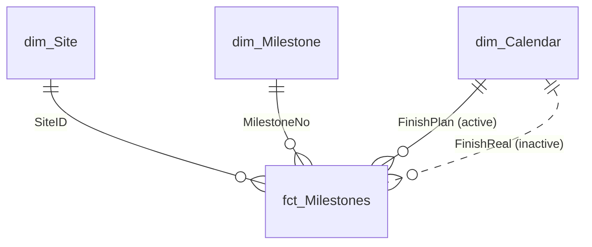

<h1 align="center">Terranova 4G 100 — Executive Project Control Dashboard</h1>

<p align="center">
  <b>Earned value, cost, schedule and risk analytics for a 100-site rural 4G rollout</b><br>
  Built with Microsoft Excel · VBA · Power Query · Power Pivot (DAX)
</p>

<p align="center">
  
  
  
  
  
  
</p>

---

## Table of contents

1. [Project title & overview](#1-project-title--overview)
2. [Role & responsibilities](#2-role--responsibilities)
3. [Challenge / problem](#3-challenge--problem)
4. [Actions / process](#4-actions--process)
5. [Results / impact](#5-results--impact)
6. [Visuals / artifacts](#6-visuals--artifacts)
7. [Lessons learned](#7-lessons-learned)
8. [Repository structure & how to use](#8-repository-structure--how-to-use)
9. [Data, assumptions & limitations](#9-data-assumptions--limitations)
10. [Author](#10-author)

---

## 1. Project title & overview

**Terranova 4G 100** is a formula-driven Excel decision-support system that consolidates the cost, schedule and risk data of a **100-site rural 4G rollout** (4 provinces, 11 milestones per site, 27 cost components) into one auditable workbook. A single province filter, a status-date control and a scenario selector re-calculate every KPI, narrative and chart in real time.

| | |
|---|---|
| **Programme budget (BAC)** | USD 11,738,833 (EUR unit costs × 1.16) — USD 117,388 per site |
| **Scale** | 100 sites · 1,100 milestone records · 99,320 people served |
| **Workbook** | 7 dashboard sheets · 16 charts · 31,763 live formulas · 26 conditional-formatting rules · 10 named ranges |
| **Extensions** | VBA reporting automation · Power Query (M) · Power Pivot star schema · DAX measures · new `Site_Performance_Scorecard` table |
| **Skills showcased** | Dashboard design · EVM · advanced formulas · data modelling · ETL · DAX · VBA · executive reporting |


---

## 2. Role & responsibilities

**Project manager and dashboard developer** — end to end: **design**, **planning**, **execution** and **recurring reporting** based on new findings and conclusions.

| Area | What I did |
|---|---|
| **Dashboard design** | Defined audiences and the KPI set (investment, cost per site and per capita, completion, on-time %, SPI, RAG); designed the one-filter-drives-everything interaction, colour semantics, print areas and the single-site profile card |
| **Planning** | Scoped seven analytical sheets, the parameter list, naming conventions, the data-model design and a reconciliation plan before building |
| **Execution** | Built ~31,800 formulas, 16 charts, validation lists and named ranges; modelled the data in Power Query / Power Pivot; wrote the VBA automation |
| **Quality assurance** | Six reconciliation checks that roll up to a model-integrity banner on every dashboard |
| **Regular reporting** | Ran the periodic cycle — roll the status date, refresh, validate, analyse variances, issue PDFs, write conclusions and recommendations |

---

## 3. Challenge / problem

Programme managers had to answer, quickly and defensibly: **how much are we investing and where? Are we on schedule? Which milestones and sites are the problem? What happens to the budget if FX or risk assumptions move?** — from data spread over 18 normalised tables.

**Goal:** replace manual consolidation with a single, parameter-driven, self-checking dashboard that answers those questions in seconds and can be re-issued every period without rebuilding anything.

| Pain point | Design response |
|---|---|
| Fragmented, multi-table lookups | Flat 1,100-row fact table, later a star schema |
| No single schedule-health measure | PV / EV / SV / SPI with parameterised RAG thresholds |
| "Late" is ambiguous | On-time tolerance parameter drives all punctuality KPIs |
| Cost totals hard to trust | 27 components reconciled to the cent + Pareto of cost drivers |
| Different audiences | Executive, cost, schedule, EVM, site and scenario views from one parameter set |
| FX / contingency uncertainty | Base / Moderate / Severe scenario engine |
| Repetitive reporting | VBA cycle: refresh → validate → log → export, blocked if any check fails |

---

## 4. Actions / process

### 4.1 Methodology

PMBOK-aligned planning, **earned value management**, **Kimball star-schema** modelling, Pareto (80/20) and sensitivity analysis, and DMAIC-style control (define → measure → analyse → improve → control).

| Phase | Key activities | Output |
|---|---|---|
| 1 Requirements | Stakeholder questions, KPI dictionary, RAG rules | KPI dictionary |
| 2 Data audit & modelling | Inventory of 18 tables, keys, flat fact table, source reconciliation | `Fact_Milestones` |
| 3 Control panel | Parameters, 10 named ranges, 6 integrity checks | `Control` |
| 4 Calculation layer | SUMIFS / COUNTIFS / AVERAGEIFS / MAXIFS feeds, Pareto, heat-maps, S-curve, scenarios | Analytical sheets |
| 5 Presentation layer | Layout, 16 charts, data bars, colour scales, RAG formatting, print areas | 7 dashboard sheets |
| 6 Data-model extension | Power Query cleaning, dimensions, calendar, DAX measures, scorecard | Star schema + new table |
| 7 Automation | VBA cycle, logging, PDF export, input guards, protection | `modTerranovaDashboard` |
| 8 Validation | Reconcile every total, test filters and scenarios | 6 / 6 checks OK |
| 9 Reporting cycle | Roll status date, refresh, analyse, issue PDFs | PDFs + `KPI_Log` |

### 4.2 Workbook architecture

| Sheet | Purpose | Charts |
|---|---|:---:|
| `Control` | Parameters (status date, tolerance, FX, SPI thresholds) and six integrity checks | – |
| `Exec_Dashboard` | Six KPI tiles, auto-generated executive summary, province filter | 6 |
| `Cost_Analysis` | Province × domain matrix, Pareto of 27 cost components, Top-10 sites | 3 |
| `Schedule_Analysis` | Milestone scorecard, lateness heat-map, slip distribution | 2 |
| `EVM_SCurve` | BAC / PV / EV / SV / SPI / RAG, monthly phasing, S-curve | 2 |
| `Site_Profile` | One-site card with 27 costs, rank, percentile and milestone timeline | 2 |
| `Scenario` | FX and contingency what-if (Base / Moderate / Severe) | 1 |
| `Fact_Milestones` + 18 source tables | Flat fact table and normalised data | – |

### 4.3 Formula toolkit

`INDEX/MATCH` (≈ 11,800 pairs) · `SUMIFS` · `COUNTIFS` · `AVERAGEIFS` · `MAXIFS` · `SUMIF` / `COUNTIF` · `IF` / `IFERROR` / `SWITCH` / `AND` / `OR` · `LARGE` / `RANK` / `PERCENTRANK` · `EDATE` / `EOMONTH` · `TEXT` for dynamic narratives. Classic functions only — no dynamic arrays — so the file runs on Excel 2019 and Microsoft 365.

### 4.4 Key decisions

| Decision | Rationale |
|---|---|
| Flat fact table | Each KPI becomes one `COUNTIFS` / `SUMIFS`; fast and auditable |
| Equal-weight milestone EV | Actual cost and physical progress were not available; limitation documented |
| Parameterised rules | Governance can change without touching formulas |
| Formulas for dashboards, Power Pivot for scale | Transparent, refresh-free executive page plus reusable measures |
| Guarded automation | No report is produced unless all six checks pass |

### 4.5 Visual Basic automation

Full module: [`vba/modTerranovaDashboard.bas`](vba/modTerranovaDashboard.bas) · event handlers: [`vba/EventHandlers.txt`](vba/EventHandlers.txt)

| Procedure | Purpose |
|---|---|
| `RunMonthlyReportCycle` | Master routine — assign to a button on `Control` |
| `RefreshAndValidate` / `ModelIsHealthy` | Refresh connections, recalculate, read the six integrity checks |
| `LogKpiSnapshot` | Append date-stamped KPIs to an auto-created `KPI_Log` sheet |
| `ExportProvinceReports` | One PDF per province filter (All + each province), then restore the filter |
| `ExportReportPack` / `ConfigurePrintLayout` | PDF per analytical sheet; landscape, fit-to-width, page-number footers |
| `ProtectDashboardSheets` / `UnprotectDashboardSheets` | Lock formulas, keep inputs editable |
| `Worksheet_Change` (Control) | Validates the status date against the data range |

```vba
Public Sub RunMonthlyReportCycle()
    If Not RefreshAndValidate() Then Exit Sub   ' blocked if any integrity check fails
    LogKpiSnapshot
    ExportProvinceReports
    ExportReportPack
    MsgBox "Reporting cycle completed." & vbCrLf & vbCrLf & _
           "Output folder:" & vbCrLf & ReportFolder(), vbInformation, APP_TITLE
End Sub
```

### 4.6 Power Query + Power Pivot

Queries: [`powerquery/Terranova_Queries.m`](powerquery/Terranova_Queries.m) · Measures: [`dax/Terranova_Measures.dax`](dax/Terranova_Measures.dax)




1. **Power Query** — parameter queries from the named ranges; `fct_Milestones` (blank → `null`, typed columns); `dim_Site`, `dim_Milestone`, `dim_Calendar`, `param_Control`.
2. **Load** — staging and dimensions as *connection only + Data Model*; the scorecard as a worksheet table + Data Model.
3. **Power Pivot** — relationships as above; `FinishReal` relationship is inactive and activated with `USERELATIONSHIP`.
4. **DAX** — BAC, PV / EV @ Status, SV, SPI, RAG, Sites RED, cumulative PV / EV.

```dax
SPI @ Status = DIVIDE ( [EV @ Status USD], [PV @ Status USD] )

EV @ Status USD =
CALCULATE (
    [BAC USD],
    USERELATIONSHIP ( fct_Milestones[FinishReal], dim_Calendar[Date] ),
    FILTER ( ALL ( dim_Calendar[Date] ), dim_Calendar[Date] <= [Status Date] )
)
```

### 4.7 New table — `Site_Performance_Scorecard`

One row per site, sorted worst-first so the top rows are the recovery watch-list (22 columns: keys, milestone counts, slip statistics, `BAC_USD`, `PV_USD`, `EV_USD`, `SV_USD`, `SPI`, `RAG`, `RolloutWave`, `InvestmentRank`). Reconciles to the dashboard: ΣPV = 8,201,089 · ΣEV = 7,627,340.

| Site | Province | Completion | Late % | Avg slip (d) | SPI | RAG | BAC (USD) |
|---|---|:-:|:-:|:-:|:-:|:-:|--:|
| Q4.03 | Asturias | 18.2% | 100% | 2.5 | 0.22 | 🔴 RED | 134,137 |
| Q4.13 | A Coruna | 18.2% | 100% | 1.5 | 0.33 | 🔴 RED | 154,817 |
| Q4.23 | Asturias | 18.2% | 50% | 2.5 | 0.33 | 🔴 RED | 59,420 |
| Q4.07 | Asturias | 18.2% | 50% | 2.5 | 0.50 | 🔴 RED | 132,996 |
| Q4.01 | A Coruna | 18.2% | 100% | 4.0 | 0.50 | 🔴 RED | 151,451 |

*Sample output at the 31-Dec-2026 status date.*

---

## 5. Results / impact

All figures are computed from the workbook at the **31-Dec-2026** status date.

### Programme position

| Metric | Result |
|---|---|
| Total investment (BAC) | **USD 11,738,833** — USD 118.19 per capita |
| Planned value / earned value | USD 8,201,089 / 7,627,340 (69.9% planned vs 65.0% earned) |
| Schedule variance | **− USD 573,749** (−7.0%) |
| Schedule performance index | **0.93 — AMBER** |
| Milestones completed | 736 of 1,100 (66.9%) |
| Completed after plan | 612 of 736 (83.2%) — average slip 2.6 days, maximum 5 |
| Site status | 68 GREEN · 3 AMBER · **29 RED** |

### Findings that drive decisions

| Finding | Evidence |
|---|---|
| **Delay is concentrated, not systemic** | 29 RED sites explain **95.1%** of the schedule shortfall; 25 are in the Q4 wave (SPI **0.56** vs 1.00 / 0.97 / 0.97) |
| **Slips are small but chronic** | 83.2% late, but average slip only 2.6 days; with a 3-day tolerance on-time rises from 16.8% to **65.6%** |
| **Sequential bottlenecks** | Negotiation 75 / 75 late · Infrastructure 63 / 64 · Transmission 50 / 51 |
| **Cost is concentrated** | Network 51.7% + Infrastructure 28.5% of BAC; **8 of 27 components = 81.4%** of cost |
| **Regional differences** | Cost per site USD 113,980 – 122,919; cost per capita USD 86.29 – 149.99 (1.74×) |
| **Risk exposure** | Moderate **+USD 1.32M (+11.2%)** · Severe **+USD 3.42M (+29.1%)** |
| **Reliable model** | 6 / 6 reconciliation checks pass to the cent |


### Efficiency benefits (design-based estimates)

> The estimates below are not measured values. Replace them with your own baseline before external use.

| Benefit | Before | After |
|---|---|---|
| Periodic report production | ≈ 1.5–2 working days | < 30 minutes |
| Province-specific executive reports | ≈ 2 hours for 5 versions | ≈ 2 minutes |
| Consolidation errors | Manual cross-checks | 0 variance across 6 automated checks |
| Scenario re-runs | Rebuild per case | 1 drop-down selection |

---

## 6. Visuals / artifacts

Add your screenshots to `docs/images/` using the names below (the three diagrams above already exist).

| File | Content | Skill it proves |
|---|---|---|
| `04_exec_dashboard_all.png` | `Exec_Dashboard`, filter = All | Dashboard design |
| `05_exec_dashboard_province.png` | Same page, one province selected | Interactivity |
| `06_evm_scurve.png` | S-curve and SPI snapshot | Earned value |
| `07_cost_pareto.png` | Pareto of cost drivers | 80/20 analysis |
| `08_schedule_heatmap.png` | Province × milestone lateness | Bottleneck analysis |
| `09_control_integrity.png` | `Control` with six checks OK | Quality assurance |
| `10_site_profile.png` | Single-site card | Drill-down |
| `11_scenario.png` | Scenario comparison | Risk analysis |
| `12_power_query.png` | Applied steps in Power Query | ETL |
| `13_power_pivot_diagram.png` | Diagram view of the star schema | Data modelling |
| `14_dax_measures.png` | Measure manager | DAX |
| `15_vba_editor.png` | VBA project and code | Automation |
| `16_reports_output.png` | `Reports` folder + `KPI_Log` | Report generation |
| `17_scorecard_table.png` | `Site_Performance_Scorecard` with RAG | New analytical table |
| `18_demo.gif` | 15–20 s screen recording: change filter and scenario, run report | End-to-end demo |

---

## 7. Lessons learned

| Lesson | Practice |
|---|---|
| **Model first, dashboard second** | A flat fact table made every KPI a single `COUNTIFS` / `SUMIFS` |
| **Parameterise every rule** | The on-time tolerance alone moves "on time" from 16.8% to 65.6% — keep rules on a control sheet |
| **Build integrity checks into the file** | Six reconciliations give users confidence; show an OK / CHECK banner |
| **Define metrics unambiguously** | "Late" is meaningless without a tolerance and a status date |
| **Clean data before modelling** | Formula blanks (`""`) break date typing in the Data Model — convert to `null` in Power Query |
| **Automate the repetitive part** | VBA with validation and error handling, never unguarded exports |
| **State the limitations** | EV uses equal milestone weights; fixed 1.16 FX; no actual costs → no CPI |

### Benefits for the organisation

| Stakeholder | Benefit |
|---|---|
| Executives | One-page, filter-driven view of investment, schedule health and risk exposure |
| PMO | Standard, auditable reporting cycle with a time-stamped KPI history |
| Province / site managers | Their own performance and the milestones needing attention |
| Finance & procurement | Cost concentration, per-site and per-capita benchmarks, contingency by domain |
| Risk management | Quantified FX and contingency exposure |
| Governance & audit | Reconciliation checks, documented assumptions, transparent formulas |

**Next steps:** recovery plan for the 25 Q4-wave sites · escalate the Negotiation → Infrastructure → Transmission sequence · add actual costs for CPI and EAC · publish the scorecard as a weekly watch-list.

---

## 8. Repository structure & how to use

```text
.
├── README.md
├── Terranova_Excel_Dashboard.xlsx          # save as .xlsm to run the macros
├── Terranova_Excel_Dashboard_Project_Description.docx
├── vba/
│   ├── modTerranovaDashboard.bas           # import into the VBA editor
│   └── EventHandlers.txt                   # paste into ThisWorkbook and the Control sheet
├── powerquery/
│   └── Terranova_Queries.m                 # one block per query
├── dax/
│   └── Terranova_Measures.dax
└── docs/
    └── images/
```

1. Open the workbook and **Save As → Excel Macro-Enabled Workbook (.xlsm)**.
2. `Alt + F11` → **File › Import File…** → `vba/modTerranovaDashboard.bas`; paste `EventHandlers.txt` into `ThisWorkbook` and the `Control` sheet module.
3. Add a button on `Control` and assign `RunMonthlyReportCycle`.
4. Power Query: **Data › Get Data › Blank Query**, paste each block of `Terranova_Queries.m`, rename the query as in its banner and load as described in the file header.
5. Power Pivot (Excel 2019 / 365 Windows): create the relationships and paste the measures from `Terranova_Measures.dax`.
6. Reconcile: BAC 11,738,833 · PV 8,201,089 · EV 7,627,340 · SPI 0.930 · 29 RED sites.

> **Requirements:** Microsoft Excel 2019 or Microsoft 365 for Windows (MAXIFS and SWITCH need 2019+; Power Pivot needs a Windows edition that includes it).

---

## 9. Data, assumptions & limitations

- Costs are EUR unit costs × **1.16 USD/EUR** (editable on `Control`); the Scenario sheet applies illustrative FX and contingency assumptions that should be replaced with your own.
- Earned value spreads each site budget **equally over its 11 milestones**; it is a schedule proxy, not a cost-loaded or physical-progress measure. No actual costs are included, so CPI and EAC are not calculated.
- `RolloutWave` is the site-code prefix (Q1–Q4).
- Confirm that the data may be published and remove any client-confidential information before pushing this repository to a public GitHub project.

---

## 10. Author

**Fernando Muñoz** — Project management, data analytics and automation · FxMr Consulting
✉ fxmr.consult@gmail.com

<sub>© 2026 Fernando Muñoz. Add a `LICENSE` file to define the terms of reuse.</sub>
