<h1 align="center">Terranova: Executive Project Control Dashboard</h1>

<p align="center">
  <b>Earned value, cost, schedule and risk analytics for a 100-site rural 4G rollout</b><br>
  Built with Microsoft Excel · VBA · Power Query · Power Pivot (DAX)
</p>

<p align="center">
  
  
  
  
  
</p>

<p align="center">
  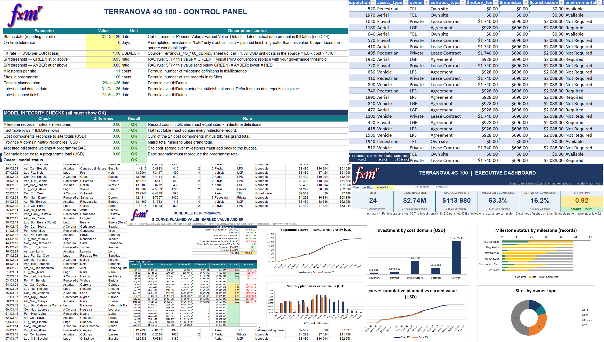
</p>

> **What it does:** one province filter, one status date and one scenario selector recalculate
> **31,763 live formulas, 16 charts and every narrative** in real time, and a guarded VBA cycle
> turns the result into a validated, date-stamped monthly report pack.

| 💶 **USD 11.74 M** program budget (BAC) | 📉 **SPI 0.93** (AMBER) | 🔴 **29 of 100 sites** cause **95.1%** of the delay | ✅ **6 / 6** integrity checks pass to the cent |
|:-:|:-:|:-:|:-:|

> **Illustrative status date.** All results below are computed at a simulated status date of **31-Dec-2026**.
> Project codename: **Terranova**.

---

## Table of contents

- [Get the workbook and quick start](#get-the-workbook-and-quick-start)
- [Project overview](#project-overview)
- [Role and Responsibilities](#role-and-responsibilities)
- [Challenge and design response](#challenge-and-design-response)
- [Results](#results)
- [Dashboard tour](#dashboard-tour)
- [Technical deep dive](#technical-deep-dive)
- [Assumptions and limitations](#assumptions-and-limitations)
- [Lessons learned and roadmap](#lessons-learned-and-roadmap)
- [Skills and evidence](#skills-and-evidence)
- [Contact](#contact)

---
## Get the workbook and quick start

| | |
|---|---|
| **Download** | [`docs/Terranova_Excel_Dashboard.xlsm`](./docs/Terranova_Excel_Dashboard.xlsm) |
| **Requirements** | Excel 2021 or Microsoft 365 for Windows (`MAXIFS` needs Excel 2019 or later); Power Pivot / Data Model enabled; macros enabled for the automation |
| **Macro safety** | The VBA is unsigned. Every module is included as plain text in [`/vba`](./vba) so you can read it before enabling macros |

**Quick start (about 3 minutes)**

1. Download the `.xlsm` file and open it. Enable macros when prompted (File → Options → Trust Center), or review [`/vba`](./vba) first.
2. Open the **`Control`** sheet and confirm the banner reads **MODEL OK** (six integrity checks).
3. Go to **`Exec_Dashboard`** and change the **province filter**. Every tile, narrative and chart updates.
4. Back on `Control`, change the **status date**, the **on-time tolerance** or the **scenario**, and compare the results.
5. Press the **Update** button to run the full reporting cycle: refresh, validate, log, export PDFs.

---

## Project Overview

**Executive Project Control Dashboard** is a formula-driven Excel decision-support system. It consolidates the cost, schedule and risk data of a **100-site rural 4G rollout** (4 provinces, 11 milestones per site, 27 cost components) into one auditable workbook.

| | |
|---|---|
| **Program budget (BAC)** | USD 11,738,833 (EUR unit costs × 1.16), or USD 117,388 per site |
| **Scale** | 100 sites · 1,100 milestone records · 99,320 people served |
| **Workbook** | 7 dashboard sheets · 16 charts · 31,763 live formulas · 26 conditional-formatting rules · 10 named ranges |
| **Extensions** | VBA reporting automation · Power Query (M) · Power Pivot star schema · DAX measures · `Site_Performance_Scorecard` table |
| **Skills showcased** | Dashboard design · EVM · advanced formulas · data modeling · ETL · DAX · VBA · executive reporting |

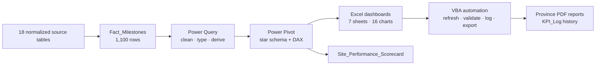

**Context:** This is an independent portfolio case study built on a realistic rollout dataset. The dataset is non-confidential and contains no employer data.

---

## Role and Responsibilities

I acted as **project manager and data analyst**, end to end: design, planning, execution and recurring reporting based on new findings and conclusions.

| Area | What I did |
|---|---|
| **Dashboard design** | Defined the audiences and the KPI set (investment, cost per site and per capita, completion, on-time %, SPI, RAG). Designed the one-filter-drives-everything interaction, colour semantics, print areas and the single-site profile card |
| **Planning** | Scoped seven analytical sheets, the parameter list, naming conventions, the data-model design and a reconciliation plan before building |
| **Execution** | Built about 31,800 formulas, 16 charts, validation lists and named ranges; modeled the data in Power Query and Power Pivot; wrote the VBA automation |
| **Quality assurance** | Six reconciliation checks that roll up to a model-integrity banner on every dashboard |
| **Regular reporting** | Ran the periodic cycle: roll the status date, refresh, validate, analyze variances, issue PDFs, write conclusions and recommendations |

---

## Challenge and design response

Program managers had to answer, quickly and defensibly: **how much are we investing and where? Are we on schedule? Which milestones and sites are the problem? What happens to the budget if FX or risk assumptions move?** The data was spread over 18 normalized tables.

**Goal:** replace manual consolidation with a single, parameter-driven, self-checking dashboard that answers those questions in seconds and can be re-issued every period without rebuilding anything.

| Pain point | Design response |
|---|---|
| Fragmented, multi-table lookups | Flat 1,100-row fact table, later extended to a star schema |
| No single schedule-health measure | PV / EV / SV / SPI with parameterized RAG thresholds |
| "Late" is ambiguous | An on-time tolerance parameter drives every punctuality KPI |
| Cost totals hard to trust | 27 components reconciled to the cent, plus a Pareto of cost drivers |
| Different audiences | Executive, cost, schedule, EVM, site and scenario views from one parameter set |
| FX and contingency uncertainty | Base / Moderate / Severe scenario engine |
| Repetitive reporting | VBA cycle: refresh → validate → log → export, blocked if any check fails |

---

## Results

All figures are computed from the workbook at the **illustrative 31-Dec-2026 status date**.

### Program position

| Metric | Result |
|---|---|
| Total investment (BAC) | **USD 11,738,833**, or USD 118.19 per capita |
| Planned value / earned value | USD 8,201,089 / 7,627,340 (69.9% planned vs 65.0% earned) |
| Schedule variance | **−USD 573,749** (−7.0%) |
| Schedule performance index | **0.93, AMBER** |
| Milestones completed | 736 of 1,100 (66.9%) |
| Completed after plan | 612 of 736 (83.2%), average slip 2.6 days, maximum 5 |
| Site status | 68 GREEN · 3 AMBER · **29 RED** |

### Findings that drive decisions

> **Reading the schedule data correctly:** lateness is *frequent but shallow* (83.2% of completed milestones are late, by only 2.6 days on average). The *material* schedule loss is *concentrated*: 29 RED sites generate 95.1% of the shortfall.

| Finding | Evidence |
|---|---|
| **Material delay is concentrated, not systemic** | 29 RED sites explain **95.1%** of the schedule shortfall; 25 are in the Q4 wave (SPI **0.56** vs 1.00 / 0.97 / 0.97 for the other waves) |
| **Slips are small but chronic** | 83.2% late, but the average slip is only 2.6 days; with a 3-day tolerance, on-time rises from 16.8% to **65.6%** |
| **Sequential bottlenecks** | Negotiation 75 / 75 late · Infrastructure 63 / 64 · Transmission 50 / 51 |
| **Cost is concentrated** | Network 51.7% + Infrastructure 28.5% of BAC; **8 of 27 components = 81.4%** of cost |
| **Regional differences** | Cost per site USD 113,980 to 122,919; cost per capita USD 86.29 to 149.99 (1.74×) |
| **Risk exposure** | Moderate scenario **+USD 1.32 M (+11.2%)** · Severe scenario **+USD 3.42 M (+29.1%)** |
| **Reliable model** | 6 / 6 reconciliation checks pass to the cent |

<p align="center">
  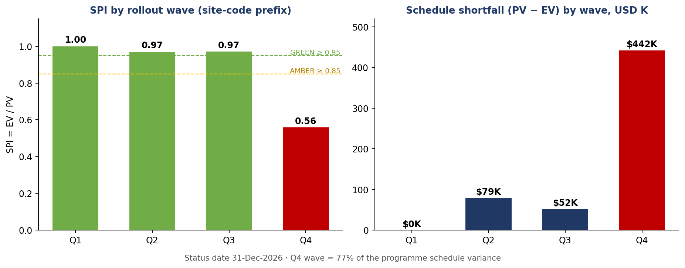
</p>

### Benefits for the organization

| Stakeholder | Benefit |
|---|---|
| Executives | One-page, filter-driven view of investment, schedule health and risk exposure |
| PMO | Standard, auditable reporting cycle with a time-stamped KPI history |
| Province and site managers | Their own performance and the milestones needing attention |
| Finance and procurement | Cost concentration, per-site and per-capita benchmarks, contingency by domain |
| Risk management | Quantified FX and contingency exposure |
| Governance and audit | Reconciliation checks, documented assumptions, transparent formulas |

---

## Dashboard tour

### 1. Control panel: parameters and integrity checks
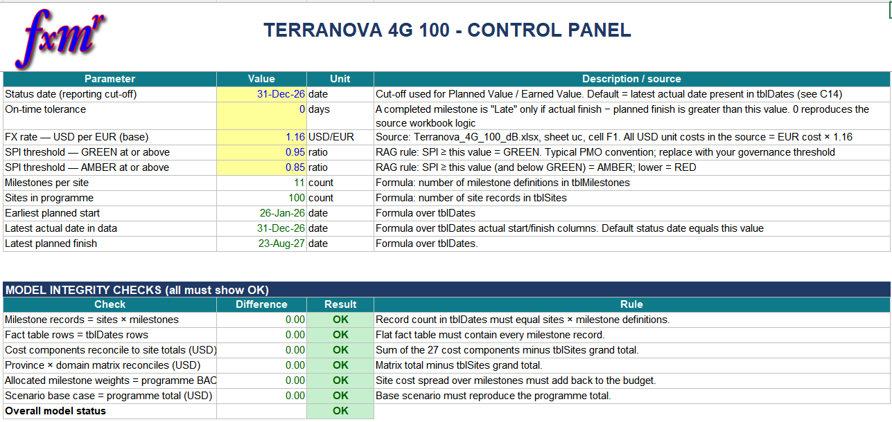

### 2. Executive dashboard: six KPI tiles and an auto-generated summary
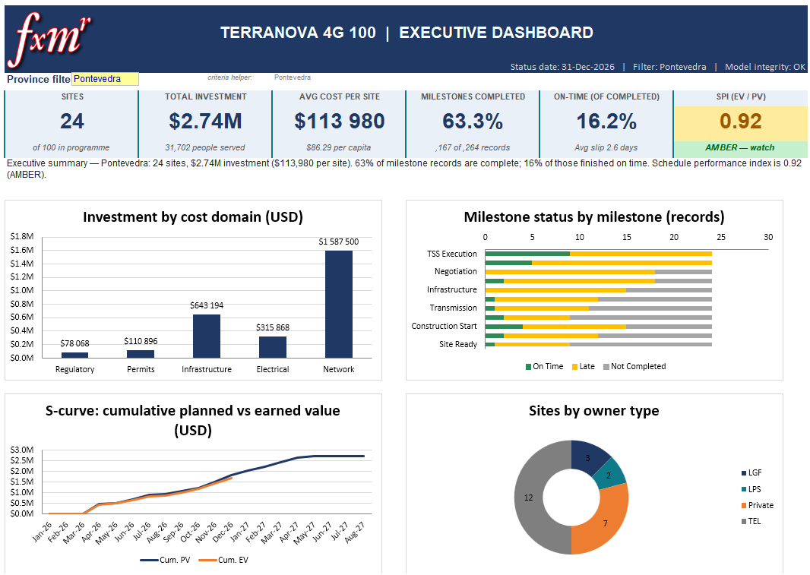

### 3. Same dashboard filtered by province (Pontevedra)
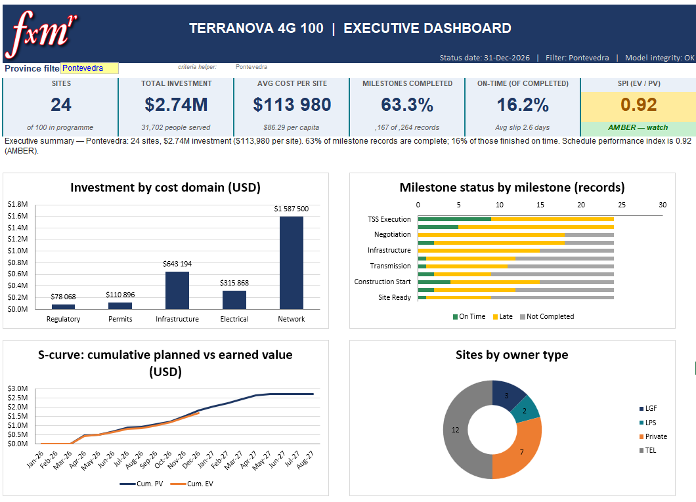

### 4. Cost analysis: province × domain matrix, Pareto of 27 components, Top-10 sites
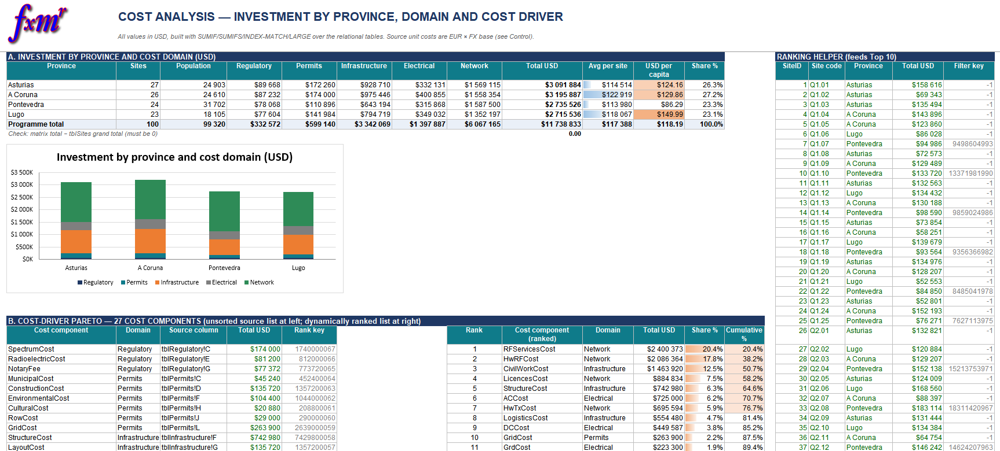

### 5. Schedule analysis: milestone scorecard, lateness heat-map, slip distribution
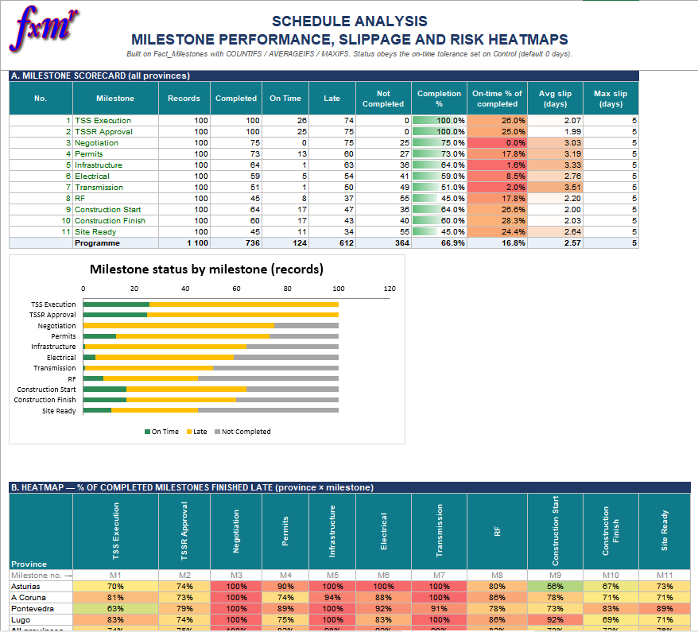

### 6. EVM S-curve: planned value vs earned value
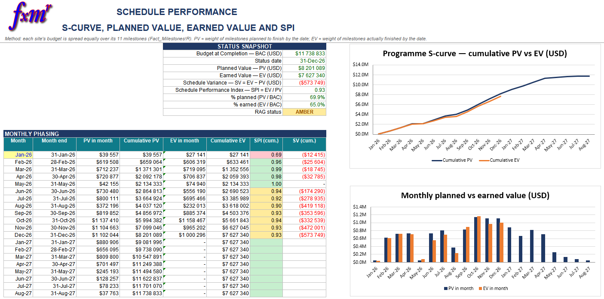

### 7. Site profile: one-site card with 27 costs, rank and milestone timeline
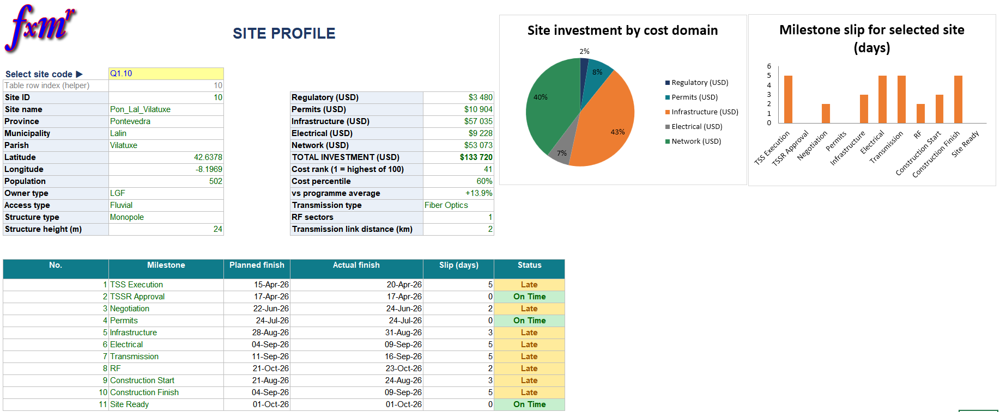


### 8. Power Pivot relationship diagram
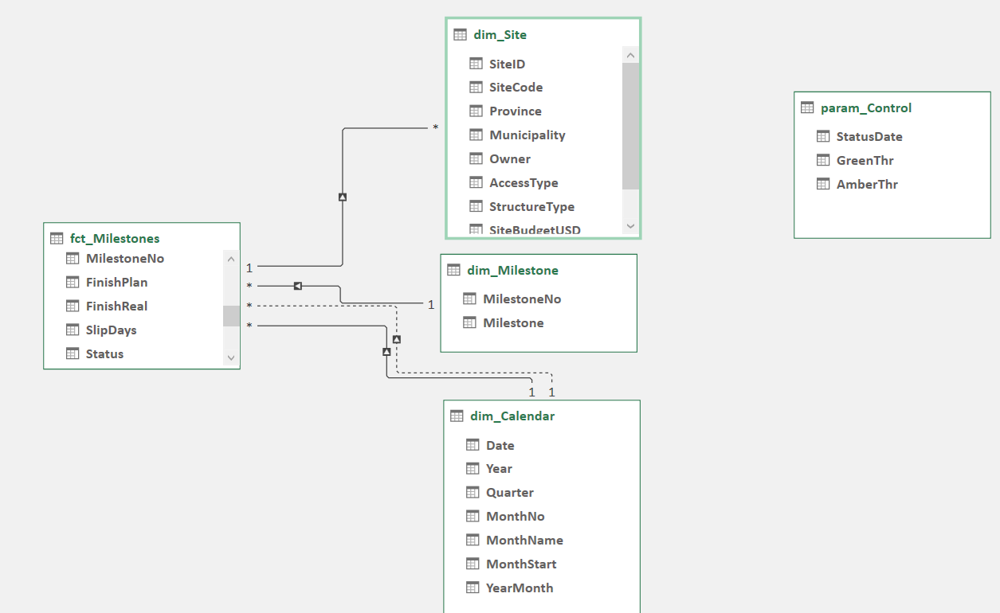

---

## Technical deep dive

The workbook sheets are summarized first; the detail sections are collapsed so you can open only what you want to review.

### Methodology

PMBOK-aligned planning, **earned value management**, **Kimball star-schema** modeling, Pareto (80/20) and sensitivity analysis, and DMAIC-style control (define → measure → analyze → improve → control).

| Phase | Key activities | Output |
|---|---|---|
| 1 Requirements | Stakeholder questions, KPI dictionary, RAG rules | KPI dictionary |
| 2 Data audit and modeling | Inventory of 18 tables, keys, flat fact table, source reconciliation | `Fact_Milestones` |
| 3 Control panel | Parameters, 10 named ranges, 6 integrity checks | `Control` |
| 4 Calculation layer | SUMIFS / COUNTIFS / AVERAGEIFS / MAXIFS feeds, Pareto, heat-maps, S-curve, scenarios | Analytical sheets |
| 5 Presentation layer | Layout, 16 charts, data bars, colour scales, RAG formatting, print areas | 7 dashboard sheets |
| 6 Data-model extension | Power Query cleaning, dimensions, calendar, DAX measures, scorecard | Star schema + new table |
| 7 Automation | VBA cycle, logging, PDF export, input guards, protection | `modTerranovaDashboard` |
| 8 Validation | Reconcile every total, test filters and scenarios | 6 / 6 checks OK |
| 9 Reporting cycle | Roll status date, refresh, analyze, issue PDFs | PDFs + `KPI_Log` |

### Workbook architecture

| Sheet | Purpose | Charts |
|---|---|:---:|
| `Control` | Parameters (status date, tolerance, FX, SPI thresholds) and six integrity checks | – |
| `Exec_Dashboard` | Six KPI tiles, auto-generated executive summary, province filter | 6 |
| `Cost_Analysis` | Province × domain matrix, Pareto of 27 cost components, Top-10 sites | 3 |
| `Schedule_Analysis` | Milestone scorecard, lateness heat-map, slip distribution | 2 |
| `EVM_SCurve` | BAC / PV / EV / SV / SPI / RAG, monthly phasing, S-curve | 2 |
| `Site_Profile` | One-site card with 27 costs, rank, percentile and milestone timeline | 2 |
| `Scenario` | FX and contingency what-if (Base / Moderate / Severe) | 1 |
| `Fact_Milestones` + 18 source tables | Flat fact table and normalized data | – |

### Key decisions

| Decision | Rationale |
|---|---|
| Flat fact table | Each KPI becomes one `COUNTIFS` / `SUMIFS`; fast and auditable |
| Equal-weight milestone EV | Actual cost and physical progress were not available; limitation documented |
| Parameterized rules | Governance can change without touching formulas |
| Formulas for dashboards, Power Pivot for scale | Transparent, refresh-free executive page plus reusable measures |
| Guarded automation | No report is produced unless all six checks pass |

<details>
<summary><b>Formula toolkit</b></summary>

`INDEX/MATCH` (≈ 11,800 pairs) · `SUMIFS` · `COUNTIFS` · `AVERAGEIFS` · `MAXIFS` · `SUMIF` / `COUNTIF` · `IF` / `IFERROR` / `SWITCH` / `AND` / `OR` · `LARGE` / `RANK` / `PERCENTRANK` · `EDATE` / `EOMONTH` · `TEXT` for dynamic narratives.

Classic functions were chosen **deliberately for Excel 2021 compatibility** (no dynamic arrays), so the file runs on Excel 2021 and Microsoft 365. An `XLOOKUP` / `LET` refactor is on the [roadmap](#lessons-learned-and-roadmap).

</details>

<details>
<summary><b>VBA automation: procedures and code</b></summary>

- Full module: [`vba/modTerranovaDashboard.bas`](./vba/modTerranovaDashboard.bas)
- Event handlers: [`vba/Sheet_Control_Event_Handler.cls`](./vba/Sheet_Control_Event_Handler.cls) · [`vba/ThisWorkbook.cls`](./vba/ThisWorkbook.cls)

| Procedure | Purpose |
|---|---|
| `RunMonthlyReportCycle` | Master routine; assign it to the **Update** button on the `Control` sheet |
| `RefreshAndValidate` / `ModelIsHealthy` | Refresh connections, recalculate, read the six integrity checks |
| `LogKpiSnapshot` | Append date-stamped KPIs to an auto-created `KPI_Log` sheet |
| `ExportProvinceReports` | One PDF per province filter (All + each province), then restore the filter |
| `ExportReportPack` / `ConfigurePrintLayout` | PDF per analytical sheet; landscape, fit-to-width, page-number footers |
| `ProtectDashboardSheets` / `UnprotectDashboardSheets` | Lock formulas, keep inputs editable |
| `Worksheet_Change` (`Control`) | Validates the status date against the data range |

```vba
Public Sub RunMonthlyReportCycle()
    If Not RefreshAndValidate() Then Exit Sub   ' blocked if any integrity check fails
    LogKpiSnapshot
    ExportProvinceReports
    ExportReportPack
    MsgBox "Reporting cycle completed." & vbCrLf & vbCrLf & _
           "Output folder:" & vbCrLf & ReportFolder(), vbInformation, APP_TITLE
End Sub
```

</details>

<details>
<summary><b>Power Query, Power Pivot and DAX</b></summary>

Queries: [`powerquery/Terranova_Queries.m`](./powerquery/Terranova_Queries.m) · Measures: [`dax/Terranova_Measures.dax`](./dax/Terranova_Measures.dax)

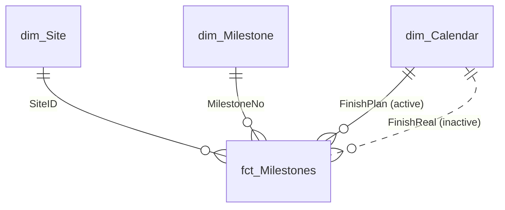

1. **Power Query:** parameter queries from the named ranges; `fct_Milestones` (blank → `null`, typed columns); `dim_Site`, `dim_Milestone`, `dim_Calendar`, `param_Control`.
2. **Load:** staging and dimensions as *connection only + Data Model*; the scorecard as a worksheet table + Data Model.
3. **Power Pivot:** relationships as above; the `FinishReal` relationship is inactive and activated with `USERELATIONSHIP`.
4. **DAX:** BAC, PV / EV @ Status, SV, SPI, RAG, Sites RED, cumulative PV / EV.

```dax
SPI @ Status = DIVIDE ( [EV @ Status USD], [PV @ Status USD] )

EV @ Status USD =
CALCULATE (
    [BAC USD],
    USERELATIONSHIP ( fct_Milestones[FinishReal], dim_Calendar[Date] ),
    FILTER ( ALL ( dim_Calendar[Date] ), dim_Calendar[Date] <= [Status Date] )
)
```

</details>

<details>
<summary><b>Power Query table: <code>Site_Performance_Scorecard</code></b></summary>

One row per site, sorted worst-first so the top rows form the recovery watch-list (22 columns: keys, milestone counts, slip statistics, `BAC_USD`, `PV_USD`, `EV_USD`, `SV_USD`, `SPI`, `RAG`, `RolloutWave`, `InvestmentRank`). It reconciles to the dashboard: ΣPV = 8,201,089 · ΣEV = 7,627,340.

| Site | Province | Completion | Late % | Avg slip (d) | SPI | RAG | BAC (USD) |
|---|---|:-:|:-:|:-:|:-:|:-:|--:|
| Q4.03 | Asturias | 18.2% | 100% | 2.5 | 0.22 | 🔴 RED | 134,137 |
| Q4.13 | A Coruña | 18.2% | 100% | 1.5 | 0.33 | 🔴 RED | 154,817 |
| Q4.23 | Asturias | 18.2% | 50% | 2.5 | 0.33 | 🔴 RED | 59,420 |
| Q4.07 | Asturias | 18.2% | 50% | 2.5 | 0.50 | 🔴 RED | 132,996 |
| Q4.01 | A Coruña | 18.2% | 100% | 4.0 | 0.50 | 🔴 RED | 151,451 |

*Sample output at the illustrative 31-Dec-2026 status date.*

</details>

---

## Assumptions and limitations

| Limitation | Impact | Mitigation / next step |
|---|---|---|
| **Equal-weight milestone EV** (each of the 11 milestones carries the same weight) | EV may over- or understate true physical progress | Weights are documented; roadmap adds cost-weighted or effort-weighted milestones |
| **No actual costs (AC)** | No CPI, EAC or cost variance; this is a schedule-and-budget view, not full EVM | Roadmap adds an AC table and CPI / EAC / TCPI measures |
| **Fixed FX rate of 1.16** (EUR → USD) | Budget in USD moves with FX; base case ignores volatility | The `Scenario` sheet stresses FX and contingency (Moderate / Severe) |
| **On-time tolerance is a parameter** | "On-time %" depends on it (16.8% at 0 days vs 65.6% at 3 days) | Tolerance is on the `Control` sheet and shown in every punctuality KPI |
| **Classic formulas only** (no dynamic arrays) | Longer formulas than modern equivalents | Chosen for Excel 2021 compatibility; `XLOOKUP` / `LET` refactor planned |
| **Illustrative status date and dataset** | Results demonstrate the method, not a live operational position | N/A |

---

## Lessons learned and roadmap

| Lesson | Practice |
|---|---|
| **Model first, dashboard second** | A flat fact table made every KPI a single `COUNTIFS` / `SUMIFS` |
| **Parameterize every rule** | The on-time tolerance alone moves "on time" from 16.8% to 65.6%; keep rules on a control sheet |
| **Build integrity checks into the file** | Six reconciliations give users confidence; show an OK / CHECK banner |
| **Define metrics unambiguously** | "Late" is meaningless without a tolerance and a status date |
| **Clean data before modeling** | Formula blanks (`""`) break date typing in the Data Model; convert to `null` in Power Query |
| **Automate the repetitive part** | VBA with validation and error handling, never unguarded exports |
| **State the limitations** | EV uses equal milestone weights; fixed 1.16 FX; no actual costs, so no CPI |

**Roadmap**

- [ ] Add actual-cost data and CPI / EAC / TCPI measures
- [ ] Cost-weighted milestone EV
- [ ] Refactor lookups to `XLOOKUP` / `LET` (keep a classic-function build for Excel 2021 users)
- [ ] Sign the VBA project with a code-signing certificate
- [ ] Power BI version of the executive page, reusing the DAX measures

---

## Skills and evidence

| Skill | Evidence in this repo | Where |
|---|---|---|
| Earned value management | PV / EV / SV / SPI, S-curve, parameterized RAG thresholds | `EVM_SCurve` sheet |
| Advanced Excel formulas | ≈ 31,800 formulas; `SUMIFS`, `COUNTIFS`, `MAXIFS`, `INDEX/MATCH`, dynamic narratives with `TEXT` | Analytical sheets |
| Dashboard design | One filter drives 6 tiles, 16 charts and an auto-written executive summary | `Exec_Dashboard` |
| Power Query (M) | Blank-to-null typing, parameter queries, dimension and calendar tables | [`powerquery/Terranova_Queries.m`](./powerquery/Terranova_Queries.m) |
| Data modeling | Kimball star schema with an inactive `FinishReal` relationship | [Power Pivot diagram](./assets/02_star_schema.png) |
| DAX | `USERELATIONSHIP`, `CALCULATE`, cumulative PV / EV | [`dax/Terranova_Measures.dax`](./dax/Terranova_Measures.dax) |
| VBA | Guarded refresh → validate → log → export cycle, sheet protection, input validation | [`vba/modTerranovaDashboard.bas`](./vba/modTerranovaDashboard.bas) |
| Data quality | Six reconciliation checks to the cent, surfaced as a banner | `Control` sheet |
| Scenario analysis | Base / Moderate / Severe FX and contingency engine | `Scenario` sheet |

---

## Contact

I build project controls, analytics and reporting automation for international teams. I am open to **remote consulting** in project management, data analytics and automation.

**Fernando Muñoz**: PMP · PSM I · Six Sigma Black Belt

- 📧 [fxmr.consult@gmail.com](mailto:fxmr.consult@gmail.com)
- 💼 [LinkedIn](https://www.linkedin.com/in/YOUR-PROFILE)
